<h1 align="center">Henrique Tornelli</h1>

  <b>Senior Gameplay Programmer</b> · Unreal Engine 5 · Unity · C++ · C#

  <a href="https://tornellihenrique.github.io/"><b>Portfolio</b></a> ·
  <a href="https://tornellihenrique.github.io/Henrique_Tornelli_Duarte_CV.pdf">CV</a> ·
  <a href="https://www.linkedin.com/in/henrique-tornelli">LinkedIn</a> ·
  <a href="https://www.layoffstudio.com/">Layoff Studios</a> ·
  <a href="mailto:tornelli.henrique@gmail.com">Email</a>

### Games

<table>
  <tr>
    <td width="50%" valign="top">
      <a href="https://tornellihenrique.github.io/work/war-rock-2/">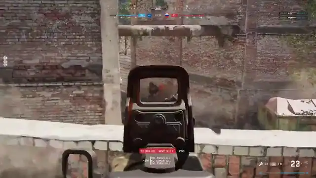</a>
       <b>War Rock 2</b>
       Realistic multiplayer FPS
    </td>
    <td width="50%" valign="top">
      <a href="https://tornellihenrique.github.io/work/wyzards/">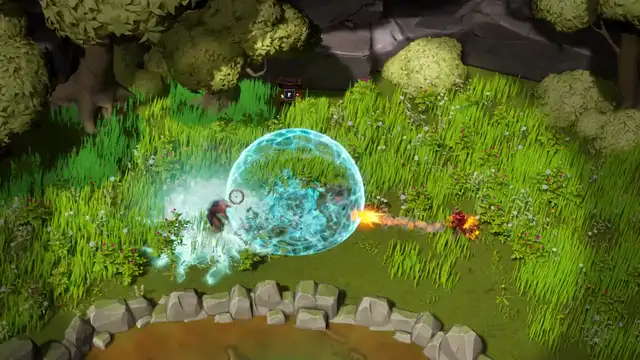</a>
       <b>wYzards</b>
       Multiplayer extraction RPG on GAS
    </td>
  </tr>
  <tr>
    <td width="50%" valign="top">
      <a href="https://tornellihenrique.github.io/work/egg-smash/">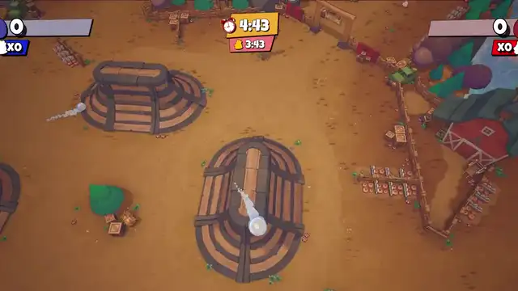</a>
       <b>Egg Smash</b>
       Networked party game from Layoff Studios
    </td>
    <td width="50%" valign="top">
      <a href="https://tornellihenrique.github.io/work/infection/">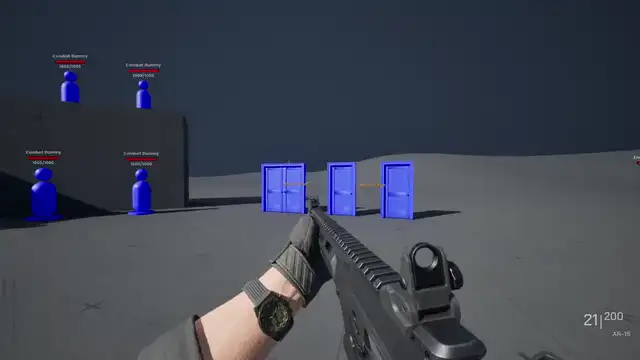</a>
       <b>Infection</b>
       Co-op zombie FPS on GAS
    </td>
  </tr>
  <tr>
    <td width="50%" valign="top">
      <a href="https://tornellihenrique.github.io/work/mobile-shooter/">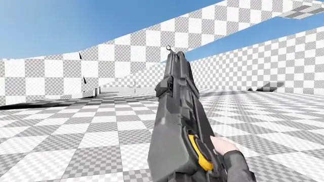</a>
       <b>Mobile shooter in Unity</b>
       Online mobile shooter in C#
    </td>
    <td width="50%" valign="top">
      <a href="https://tornellihenrique.github.io/work/team-deathmatch-fps/">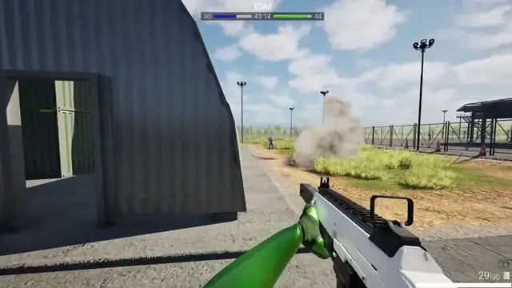</a>
       <b>Team Deathmatch FPS</b>
       Multiplayer FPS with Steam sessions
    </td>
  </tr>
</table>

### Plugins

<table>
  <tr>
    <td width="50%" valign="top">
      <a href="https://tornellihenrique.github.io/work/procedural-first-person-toolkit/">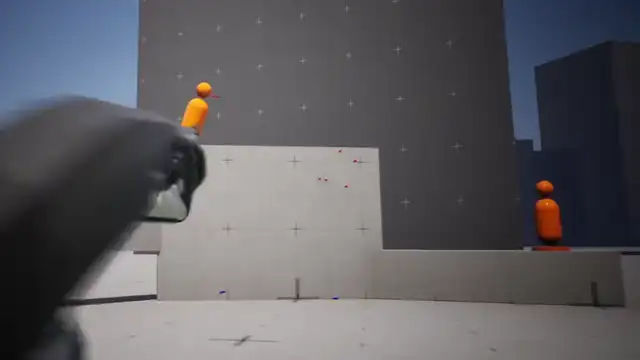</a>
       <b>Procedural First Person Toolkit</b>
       Commercial UE5 plugin, 75+ licenses
    </td>
    <td width="50%" valign="top">
      <a href="https://tornellihenrique.github.io/work/true-fps-system/">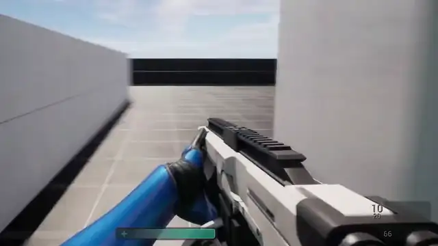</a>
       <b>True FPS System</b>
       Replicated UE5 FPS plugin
    </td>
  </tr>
</table>

### Projects and systems

<table>
  <tr>
    <td width="33%" align="center">
      <a href="https://tornellihenrique.github.io/work/bunny-hopping/">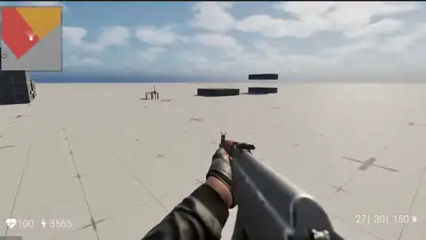</a>
       BunnyHopping
    </td>
    <td width="33%" align="center">
      <a href="https://tornellihenrique.github.io/work/spatial-inventory/">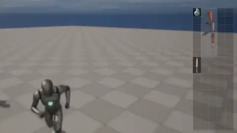</a>
       Spatial Inventory
    </td>
    <td width="33%" align="center">
      <a href="https://tornellihenrique.github.io/work/flag-capture/">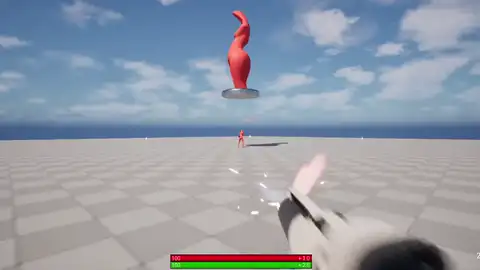</a>
       FlagCapture
    </td>
  </tr>
  <tr>
    <td width="33%" align="center">
      <a href="https://github.com/SlapStudios/ALS-Refactored-Manny">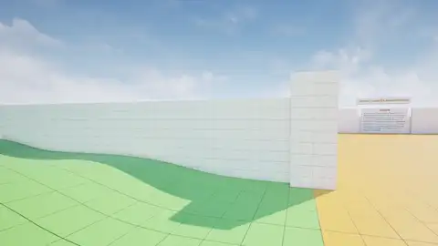</a>
       ALS-Refactored Manny
    </td>
    <td width="33%" align="center">
      <a href="https://tornellihenrique.github.io/work/movement-systems/#vault">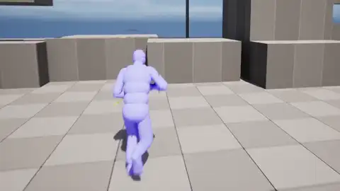</a>
       Vault
    </td>
    <td width="33%" align="center">
      <a href="https://tornellihenrique.github.io/work/movement-systems/#ladder">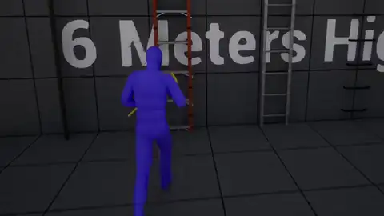</a>
       Ladder
    </td>
  </tr>
</table>

Everything else, including the rest of the movement systems and my tutorials, is on the [portfolio](https://tornellihenrique.github.io/#projects).

### Read the code

- **[TrueFPSSystemPlugin](https://github.com/tornellihenrique/TrueFPSSystemPlugin):** replicated UE5 FPS plugin with weapons, attachments, bots and online sessions.
- **[FPSGame](https://github.com/tornellihenrique/FPSGame):** the project from my live course, with a procedural motion node and an equipment framework.
- **[BulletSystem](https://github.com/tornellihenrique/BulletSystem):** physically simulated ballistics with drag, wind, penetration, ricochet and actor pooling.
- **[FlagCapture](https://github.com/tornellihenrique/FlagCapture):** capture-the-flag multiplayer shooter on GAS.
- **[spatial-inventory-basic](https://github.com/tornellihenrique/spatial-inventory-basic):** replicated grid inventory in C++.
- **[ALS-Refactored Manny](https://github.com/SlapStudios/ALS-Refactored-Manny):** slide, prone and camera limits on an open source locomotion system.
